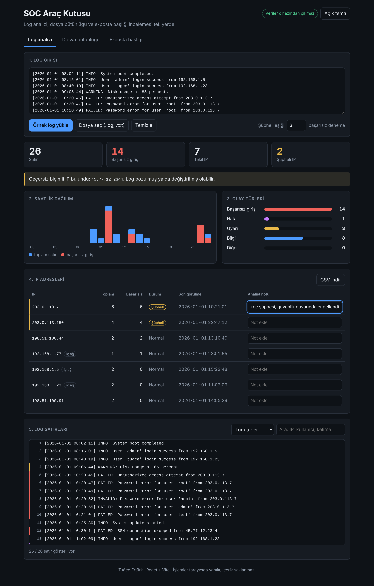
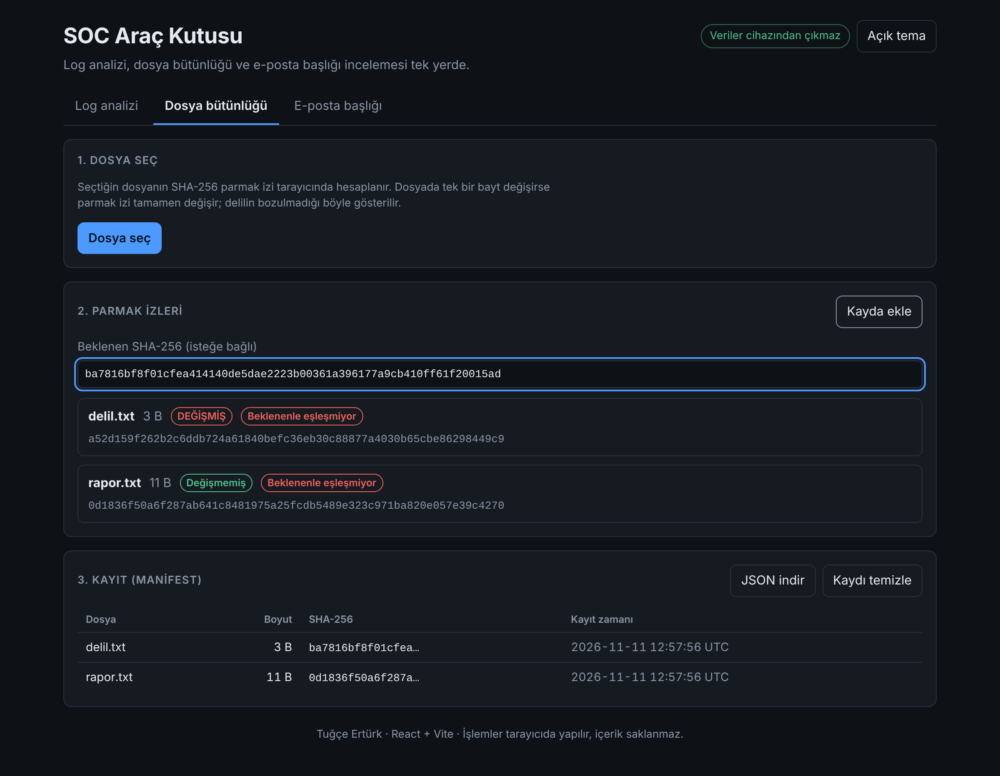
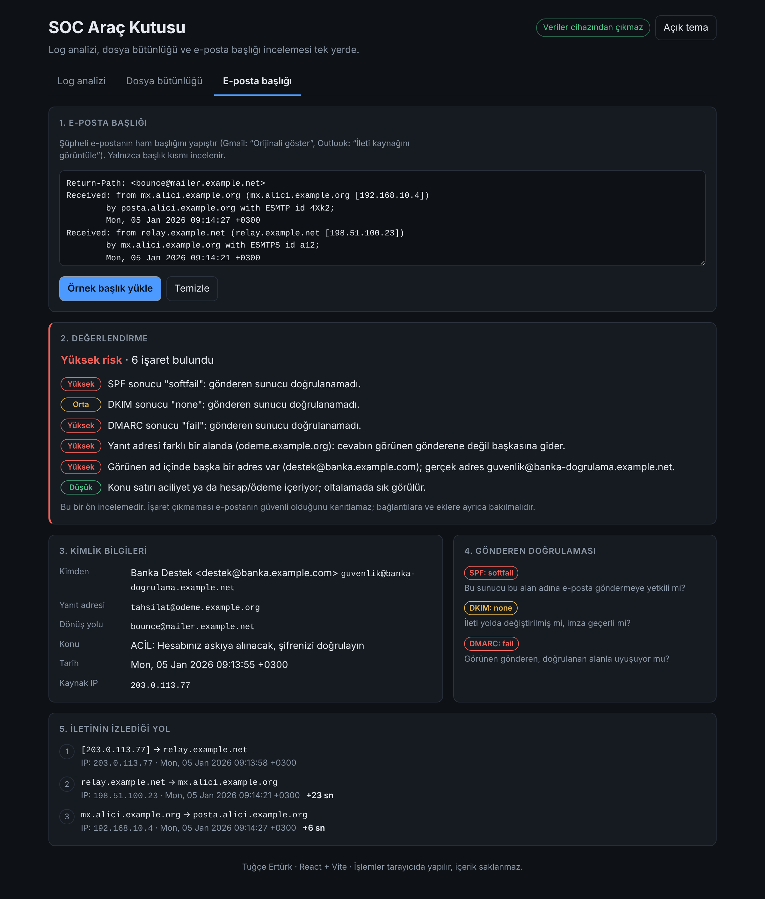

# SOC Araç Kutusu

Bir SOC analistinin ve adli bilişim uzmanının ilk bakışta ihtiyaç duyduğu üç aracı tek sayfada toplayan web uygulaması. Bütün işlemler tarayıcıda yapılır; log, dosya ya da e-posta içeriği hiçbir sunucuya gönderilmez.

**Web Geliştirme; Yapay Zeka Eğitimi – proje ödevi · Tuğçe Ertürk**

- Canlı adres: _yayınlanınca eklenecek_
- Depo: https://github.com/therturk35/soc-arac-kutusu

| Log analizi | Dosya bütünlüğü | E-posta başlığı |
|---|---|---|
|  |  |  |

Açık tema: [docs/acik-tema.png](docs/acik-tema.png)

## Neden bu proje?

Adli Bilimler mezunuyum ve SOC analisti olmayı hedefliyorum. Bu üç araç, Python ile siber güvenlik dersinde komut satırında yazdığım çalışmaların web sürümü:

| Araç | Dersteki karşılığı | Web sürümünde eklenen |
|---|---|---|
| Log analizi | Regex ile logdan IP ayıklama (`regex_log_analiz_ipbulucu.py`, `server.log`) | Başarısız giriş sayımı, şüpheli eşiği, grafikler, analist notu, CSV raporu |
| Dosya bütünlüğü | SHA-256 ile kanıt dosyası doğrulama (`hash_02_butunluk.py`) | Çoklu dosya, beklenen hash karşılaştırması, kalıcı kayıt (manifest) |
| E-posta başlığı | Oltalama konusu (web güvenliği başlıkları) | Received zinciri, SPF/DKIM/DMARC, sahte gönderen işaretleri |

Makine öğrenmesi projemde ağ trafiğine bakan modelin parola tahmini saldırılarını kaçırdığını görmüştüm; o saldırıların izi loglarda olduğu için log analizi aracı o çalışmanın devamı niteliğinde.

## Özellikler

**Log analizi**
- Log yapıştırma, `.log` / `.txt` dosyası yükleme (en fazla 5 MB) ve hazır örnek log
- Özet sayılar, saatlik dağılım ve olay türü grafikleri
- Ayarlanabilir şüpheli eşiği; IP tablosu, iç ağ etiketi, analist notu, CSV indirme
- Geçersiz biçimli IP uyarısı (ör. `45.77.12.2344`), süzme ve arama
- Yüklenen log dosyasının SHA-256 parmak izi (delil zinciri için)

**Dosya bütünlüğü**
- Bir ya da birden çok dosyanın SHA-256 parmak izi (Web Crypto API, en fazla 200 MB)
- Beklenen hash ile karşılaştırma
- Kayıt (manifest): parmak izini sakla, dosyayı sonra yeniden seç, "Değişmemiş / DEĞİŞMİŞ" sonucunu gör; kaydı JSON olarak indir

**E-posta başlığı**
- Ham başlıktan gönderen, yanıt adresi, dönüş yolu, konu, tarih ve kaynak IP
- SPF, DKIM, DMARC sonuçları
- İletinin sunucular arasında izlediği yol ve duraklar arası gecikme
- Risk işaretleri: farklı yanıt adresi, görünen ad içine gizlenmiş sahte adres, başarısız doğrulama, aciliyet içeren konu

**Genel**
- Koyu ve açık tema, mobil uyumlu düzen, sekmeler arasında veri kaybolmaz
- LocalStorage'da yalnızca ayarlar, analist notları ve parmak izi kaydı tutulur

## Kurulum

Node.js 20 veya üstü gerekir.

```bash
npm install
npm run dev      # geliştirme sunucusu
npm test         # birim testleri (37 test)
npm run build    # yayın için derleme (dist/)
```

## Kullanılan teknolojiler

| Alan | Seçim |
|---|---|
| Framework | React 19 + Vite |
| Stil | Saf CSS (CSS değişkenleri, grid, flexbox, medya sorguları) |
| Veri saklama | LocalStorage (sunucu ve veritabanı yok) |
| Parmak izi | Web Crypto API (`crypto.subtle.digest`) |
| Test | Vitest |
| Yayın | Netlify veya Vercel (güvenlik başlıkları `public/_headers` ve `vercel.json` içinde) |

Grafikler için kütüphane kullanılmadı; çubuklar CSS ile çizildi.

## Yapay zeka nerede ve nasıl kullanıldı?

Yapay zeka asistanı olarak **Claude** kullanıldı. Kodun büyük kısmını Claude yazdı; konuyu, kapsamı ve güvenlik önceliklerini ben belirledim, çıktıyı çalıştırıp inceledim.

**1. Planlama.** Derste gösterilen "iyi prompt" yapısı izlendi: önce teknoloji yığını, sonra özellik listesi, sonra sıra.

> Teknoloji: React + Vite, saf CSS, LocalStorage; sunucu yok.
> Uygulama: üç sekme olsun. (1) Log: başarısız girişler sayılsın, IP adresleri çıkarılsın, eşiği geçen IP şüpheli sayılsın, analist not ekleyebilsin, rapor CSV olarak insin. (2) Dosya bütünlüğü: SHA-256 hesaplansın, beklenen değerle ve kayıtla karşılaştırılsın. (3) E-posta başlığı: gönderen bilgileri, doğrulama sonuçları ve izlenen yol çıkarılsın, şüpheli işaretler listelensin.
> Sıra: 1) çözümleme fonksiyonları ve testleri, 2) arayüz bileşenleri, 3) tema ve mobil düzen, 4) güvenlik kontrolleri.

**2. Kod üretimi.** Çözümleyiciler (`src/lib/`), arayüz bileşenleri (`src/bolumler/`), stiller ve testler Claude ile yazıldı.

**3. Kod inceleme.** Derste verilen beş soru üretilen koda uygulandı:

| Soru | Bulunan ve yapılan |
|---|---|
| Hata var mı? | 37 birim testi yazıldı. Testler gerçek bir hatayı yakaladı: gönderen satırında görünen adın içine sahte bir adres yazılınca kod onu gerçek adres sanıyordu. Düzeltildi; artık en sondaki `<...>` adresi esas alınıyor. |
| Edge case var mı? | Boş satırlar, saat bilgisi olmayan satırlar ve `45.77.12.2344` gibi geçersiz IP'ler ayrı ele alındı. Bu örnek, siber güvenlik dersimdeki log dosyasından geldi. |
| Performans problemi var mı? | Dosya boyutu 5 MB ile sınırlandı, ekranda en fazla 300 satır gösteriliyor, analiz yalnızca metin ya da eşik değişince yeniden çalışıyor. |
| Güvenlik problemi var mı? | Aşağıdaki "Güvenlik" bölümü. |
| Daha okunabilir olabilir mi? | Çözümleme mantığı arayüzden ayrı bir dosyaya alındı; her fonksiyon tek iş yapıyor. |

**4. Doğrulama.** Yapay zekanın önerdiği API'ler derlenip tarayıcıda çalıştırılarak denendi (derste anlatılan "halüsinasyon" riskine karşı). Uygulama otomatik tarayıcı testiyle masaüstü ve mobil genişlikte açıldı; konsolda hata yok.

## Güvenlik

Derste geçen web güvenliği başlıklarından bu projeyle ilgili olanlar:

- **Oltalama (phishing):** E-posta başlığı aracı sahte gönderen işaretlerini gösterir.
- **XSS:** Log satırları ve e-posta başlıkları saldırganın yazdığı metni içerebilir. İçerik React ile düz metin olarak basılıyor, `dangerouslySetInnerHTML` kullanılmıyor. `` içeren bir satırla denendi; kod çalışmadı.
- **Brute force:** Panonun tespit ettiği şey bu. Aynı IP'den eşik kadar başarısız deneme gelince adres işaretlenir.
- **Gizli bilgi sızıntısı:** Depoda anahtar, parola ya da `.env` dosyası yok. Log, dosya ve e-posta içeriği hiçbir yere gönderilmez ve LocalStorage'a yazılmaz; yalnızca ayarlar, notlar ve parmak izi kaydı (dosya adı, boyut, hash) saklanır.
- **CSV injection:** `=`, `+`, `-`, `@` ile başlayan hücreler indirilen CSV'de etkisizleştiriliyor.
- **Güvenlik başlıkları:** Yayında Content-Security-Policy, `X-Content-Type-Options`, `X-Frame-Options` ve `Referrer-Policy` gönderiliyor.

Örnek verilerdeki dış IP adresleri ve alan adları belgeleme için ayrılmıştır (RFC 5737, RFC 2606), gerçek sistemlere ait değildir.

## Sınırlar

- Başarısız girişler anahtar kelimelerle (failed, invalid, unauthorized, denied vb.) tanınır; farklı biçimli loglarda kaçırabilir.
- Yalnızca IPv4 adresleri çıkarılır.
- Şüpheli kararı tek bir eşiğe dayanır; zaman penceresi (ör. 1 dakikada 5 deneme) hesaba katılmaz.
- E-posta aracı başlıktaki doğrulama sonuçlarını okur; SPF/DKIM kontrolünü kendisi yapmaz. Başlığı saldırgan yazdığı için sonuçlar bir ön incelemedir, kesin hüküm değildir.
- Dosya bütünlüğünde dosyalar belleğe okunur; çok büyük disk imajları için uygun değildir.
